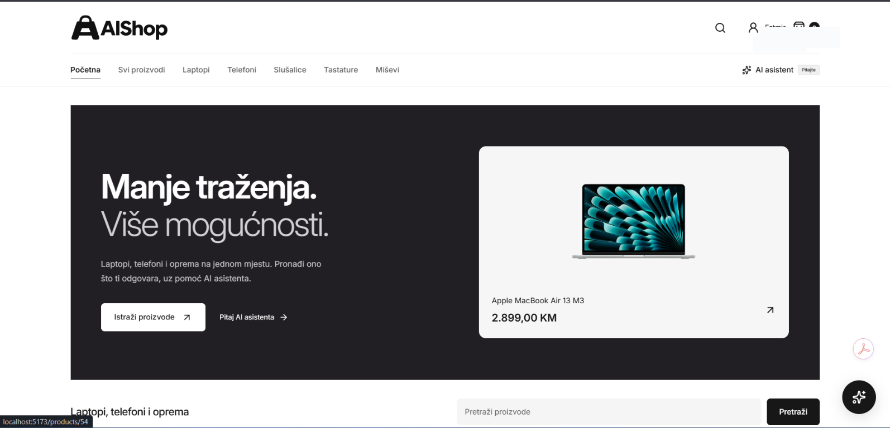
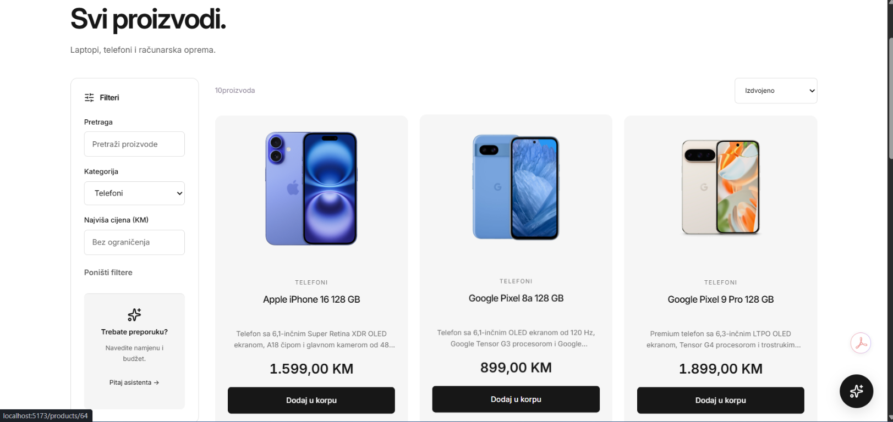
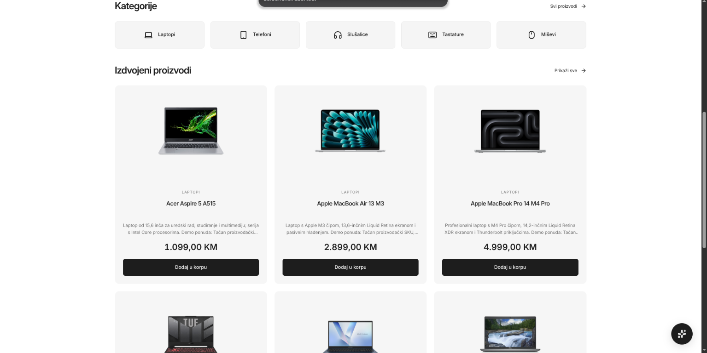
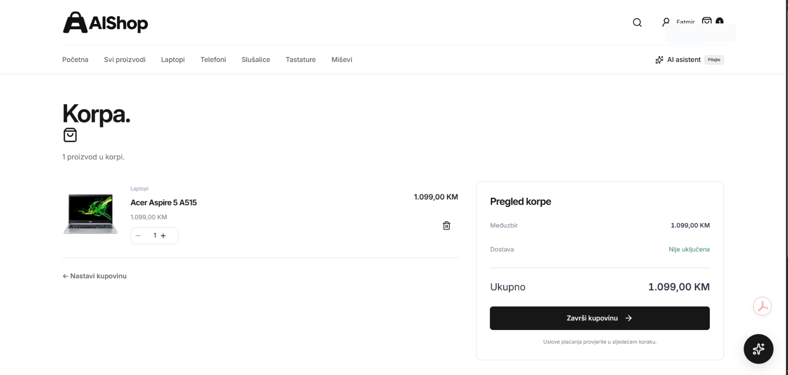
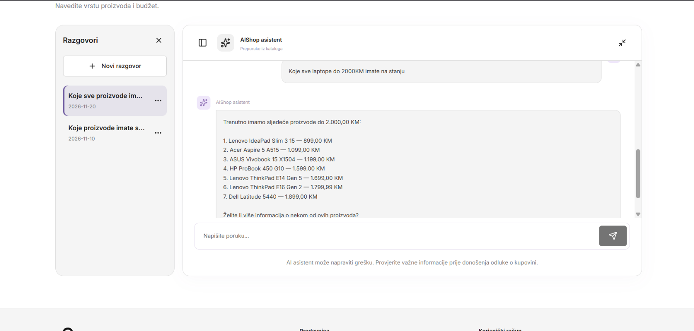
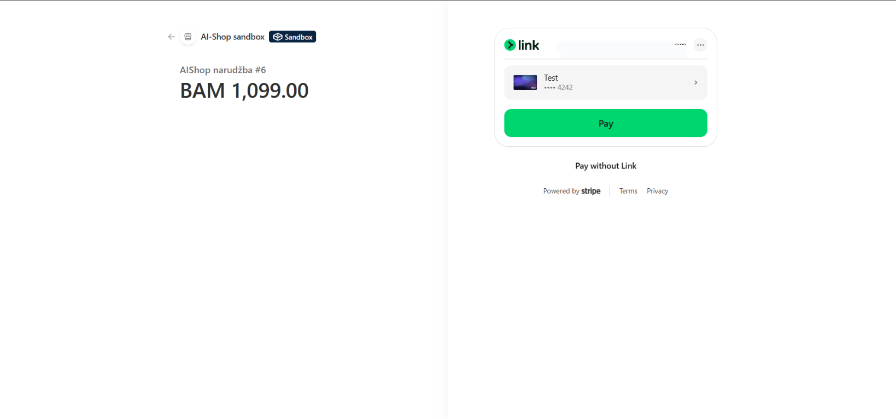

# AIShop

AIShop is a local full-stack electronics storefront with an AI assistant, user and administrator areas, Microsoft SQL Server, and Stripe Sandbox integration.

> Bosnian documentation: [README.md](README.md)

## Screenshots

### Home page



### Catalog and products

<table>
  <tr>
    <td align="center">
      
      <br>
      <strong>Product search and filtering</strong>
    </td>
    <td align="center">
      
      <br>
      <strong>Categories and featured products</strong>
    </td>
  </tr>
</table>

### Shopping cart



### AI assistant



### Stripe Sandbox checkout



> The Stripe screenshot shows Sandbox/Test mode only. No real card or payment was used.

## About the project

The project is a complete local demonstration of full-stack development and artificial intelligence integration with a real catalog, shopping cart, order flow and database.

## Main features

### Catalog and shopping

- browse categories and products
- search, filter and sort
- product details and stock availability
- SQL-backed cart with real cart-item IDs
- update quantities and remove items
- create orders and view purchase history
- separate USER and ADMIN interfaces

### Users and administration

- registration and login
- JWT access token and rotating refresh token
- profile view and name updates
- administrator user directory
- create, update and delete products
- view orders and perform allowed status transitions
- manage payments and refunds

### AI assistant

- conversations in Bosnian
- conversation history stored in SQL Server
- context carried across previous messages
- real catalog and stock search
- access to the user's cart and orders
- proposal for adding, updating or removing cart items
- explicit user confirmation before cart mutations
- protection against repeated execution of the same request

## MCP integration

MCP is a central part of AIShop. React never calls MCP directly and has no direct database access. Ollama decides through Spring AI when to invoke an MCP tool, while the Spring Boot MCP server executes it against real application data.

### Implemented MCP tools

| MCP tool | Purpose |
| --- | --- |
| `getCategories` | reads catalog categories |
| `searchProducts` | searches products by name, price, category and stock |
| `getProductDetails` | reads one product |
| `getMyCart` | reads the authenticated user's cart and real `itemId` values |
| `addToCart` | prepares adding a product |
| `updateCartQuantity` | prepares changing an existing cart-item quantity |
| `removeFromCart` | prepares removing a cart item |
| `getMyOrders` | reads the authenticated user's orders |

The user identity comes from the validated JWT in the MCP transport context. MCP tools do not accept a client-controlled user identifier for user-owned data.

### AI cart flow

1. the user asks for a product category or item;
2. Ollama invokes the appropriate MCP tool;
3. the answer is based on real catalog and stock data;
4. the user requests a cart action;
5. MCP prepares a structured proposal;
6. the frontend asks the user to confirm;
7. confirmation checks ownership and expiration;
8. the cart service executes the action only once;
9. the cart and totals are refreshed from the backend.

This separates reading, proposing and writing. An AI response cannot modify the database without explicit user confirmation.

## System architecture

```text
React 19 / Vite
        |
        | HTTP, JWT and refresh token
        v
Spring Boot REST API
        |
        +--> Spring Security and JWT
        +--> JPA / Hibernate
        +--> Flyway migrations
        +--> Spring AI / Ollama
        |              |
        |              v
        |          MCP client
        |              |
        |              v
        +---- MCP server and MCP tools
        |
        +--> Stripe Checkout and webhooks
        |
        v
Microsoft SQL Server
```

The frontend uses feature, component, service, adapter and utility layers. The API adapter centrally manages Axios timeouts, JWT headers, refresh sessions, Zod validation and network error handling.

The backend is organized into controllers, services, MCP tools, repositories, entities, DTO models and configuration.

## Database

The application uses Microsoft SQL Server. Flyway automatically applies migrations from `bekend/src/main/resources/db/migration`.

### Main concepts and tables

- `categories` — five defined catalog categories
- `products` — name, description, price, stock and image
- `users` — user profiles and password hashes
- `refresh_tokens` — rotating refresh tokens
- `shopping_carts` and `cart_items` — carts and cart items
- `orders` and `order_items` — order and ordered-product snapshots
- `shipping_addresses` — order delivery data
- `ai_conversations` and messages — assistant conversation history
- Stripe fields — checkout session, amount, currency and payment/refund status

Migrations cover table creation, required categories, AI conversations, shipping, Stripe payments and refunds.

Pessimistic locking is used for sensitive operations such as checkout, cancellation and stock restoration to prevent duplicate execution.

## Authentication and security

- passwords are stored as BCrypt hashes
- JWT access tokens use the real database user ID as `sub`
- JWT roles become `ROLE_USER` and `ROLE_ADMIN`
- refresh tokens are stored in sessionStorage and rotated
- access tokens remain in memory
- protected routes verify user and administrator permissions
- carts and orders verify resource ownership
- MCP identity comes from a validated backend transport context
- AI proposals expire and can be confirmed only once
- Stripe webhooks require valid signatures and independent data validation

## Stripe integration

- catalog and order amounts use BAM/KM
- Stripe amounts are converted to minor currency units
- an open checkout session can be reused
- an expired session is replaced by a new one
- returning from Stripe without payment does not cancel an order automatically
- refunds verify the order, amount and original session
- a successful refund restocks and cancels an order only once

The integration is designed for Stripe Sandbox/Test mode and does not use real payments.

## Run locally

### Prerequisites

- JDK 25
- Node.js and npm
- Microsoft SQL Server
- `AIShop` database
- Ollama with a tool-calling-capable model
- Stripe test key and CLI

Detailed setup:

- [LOCAL_SETUP.md](LOCAL_SETUP.md)
- [docs/demonstracija.md](docs/demonstracija.md)
- [docs/placanje.md](docs/placanje.md)
- [docs/ai-conversations.md](docs/ai-conversations.md)

### Backend

```powershell
cd bekend
$env:DB_USERNAME="sql_login"
$env:DB_PASSWORD="sql_password"
$env:JWT_SECRET="base64_secret_at_least_32_bytes"
$env:OLLAMA_MODEL="model_name"
.\mvnw.cmd spring-boot:run
```

The backend runs on port `8081`.

### Frontend

```powershell
cd frontend
npm ci
npm run dev
```

The frontend runs at `http://localhost:5173`.

## Tests

```powershell
cd frontend
npm run lint
npm test
npm run build
```

```powershell
cd bekend
.\mvnw.cmd test
.\mvnw.cmd package -DskipTests
```

Focused backend tests that do not require SQL Server:

```powershell
.\mvnw.cmd "-Dtest=PendingCartActionServiceTests,UserApiSecurityTests,ProductServiceTests" test
```

Tests cover authentication, resource ownership, cart actions, Stripe behavior, status transitions, stock restoration and product deletion.

## Technology stack

**Frontend**

- React 19
- Vite 8
- React Router 7
- TanStack Query
- Axios
- Zod
- Tailwind CSS 4
- Lucide React
- Framer Motion

**Backend**

- Java 25
- Spring Boot 4
- Spring Security
- Spring Data JPA
- Hibernate
- Flyway
- Spring AI
- Spring AI MCP
- Ollama
- JWT/OAuth2 Resource Server
- Stripe Java SDK

**Database and tools**

- Microsoft SQL Server
- Maven
- npm
- Stripe CLI

## Local project limitations

- Stripe integration is test-only
- AI quality depends on the local Ollama model
- MCP actions are stored in memory and lost after backend restart
- no email notifications or password-reset service
- no carrier or delivery integration
- mock and API modes contain separate data
