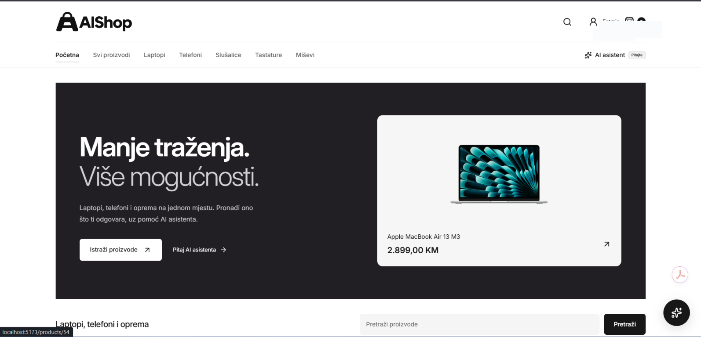
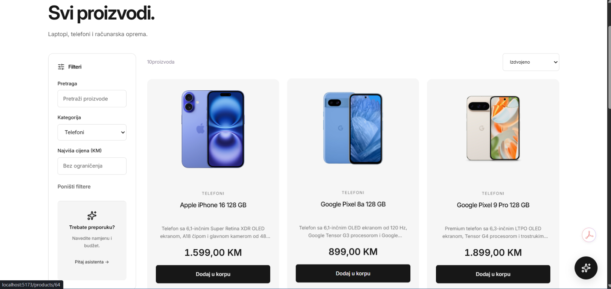
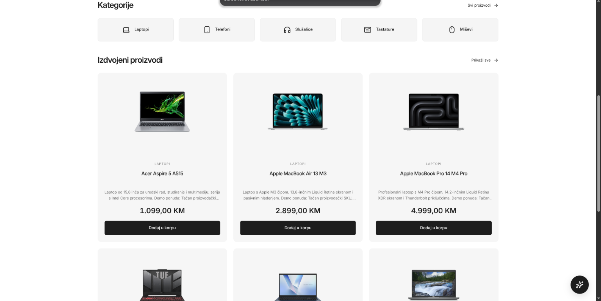
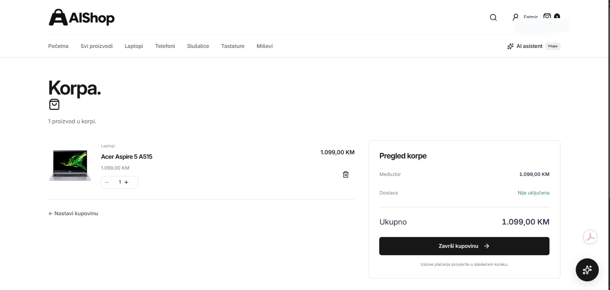
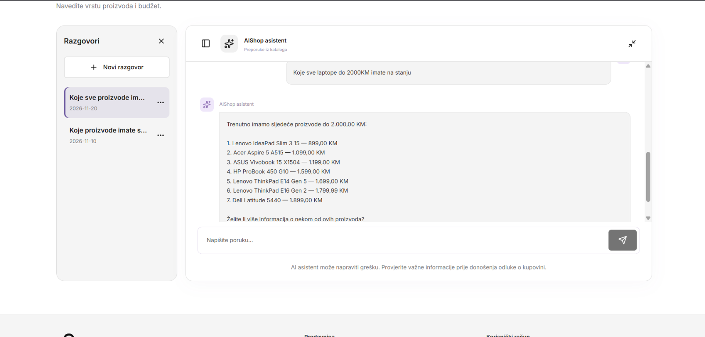
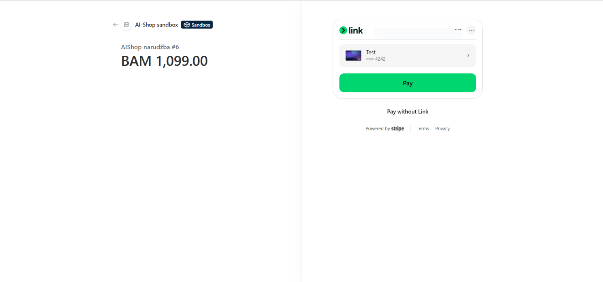

# AIShop

AIShop je lokalna full-stack online prodavnica elektronike sa AI asistentom, korisničkim i administratorskim dijelom, Microsoft SQL Server bazom podataka i Stripe Sandbox integracijom.

> English documentation: [README.en.md](README.en.md)

## Snimci ekrana

### Početna stranica



### Katalog i proizvodi

<table>
  <tr>
    <td align="center">
      
      <br>
      <strong>Pretraga i filtriranje proizvoda</strong>
    </td>
    <td align="center">
      
      <br>
      <strong>Kategorije i izabrani proizvodi</strong>
    </td>
  </tr>
</table>

### Korpa



### AI asistent



### Stripe Sandbox plaćanje



> Stripe snimak prikazuje isključivo Sandbox/Test režim. Prava kartica ili stvarna naplata nisu korišteni.

## O projektu

Projekt je napravljen kao cjelovita lokalna demonstracija full-stack razvoja i integracije umjetne inteligencije u realan katalog, korpu i proces naručivanja.

## Glavne funkcionalnosti

### Katalog i kupovina

- pregled kategorija i proizvoda
- pretraga, filtriranje i sortiranje
- detalji proizvoda i trenutna dostupnost
- SQL korpa sa stvarnim `cart item` identifikatorima
- promjena količine i uklanjanje proizvoda iz korpe
- kreiranje narudžbe iz baze i prikaz historije
- odvojeni USER i ADMIN interfejs

### Korisnički račun i administracija

- registracija i prijava
- JWT pristupni token i rotirajući refresh token
- korisnički profil i izmjena imena i prezimena
- administratorski pregled korisnika
- kreiranje, izmjena i brisanje proizvoda
- pregled narudžbi i dozvoljene promjene statusa
- upravljanje plaćanjem i povratima

### AI asistent

- razgovor na bosanskom jeziku
- čuvanje historije razgovora u SQL Server bazi
- razumijevanje prethodnih poruka i proizvoda iz razgovora
- pretraga stvarnog kataloga i provjera zaliha
- pristup korisnikovoj korpi i narudžbama
- priprema dodavanja, izmjene i uklanjanja stavki
- aktivna korisnikova potvrda prije svake promjene korpe
- zaštita od ponovljenog izvršavanja istog zahtjeva

## MCP integracija

MCP predstavlja centralni dio AIShop sistema. React ne poziva MCP direktno i nema pristup bazi. Ollama preko Spring AI modela odlučuje kada pozvati MCP alat, a Spring Boot MCP server izvršava alat koristeći stvarne podatke iz aplikacije.

### Implementirani MCP alati

| MCP alat | Opis |
| --- | --- |
| `getCategories` | čita kategorije iz SQL kataloga |
| `searchProducts` | pretražuje proizvode po nazivu, cijeni, kategoriji i zalihama |
| `getProductDetails` | vraća detalje jednog proizvoda |
| `getMyCart` | čita korpu prijavljenog korisnika i stvarne `itemId` vrijednosti |
| `addToCart` | priprema dodavanje proizvoda u korpu |
| `updateCartQuantity` | priprema promjenu količine postojeće stavke |
| `removeFromCart` | priprema uklanjanje stavke iz korpe |
| `getMyOrders` | čita narudžbe prijavljenog korisnika |

Identitet korisnika dolazi iz validiranog JWT-a u MCP transport kontekstu. MCP alat ne prima ID korisnika kao parametar koji kupac može proizvoljno promijeniti.

### AI tok promjene korpe

1. korisnik pita za određenu vrstu proizvoda;
2. Ollama poziva odgovarajući MCP alat;
3. odgovor se zasniva na stvarnom katalogu i zalihama;
4. korisnik traži dodavanje ili izmjenu proizvoda;
5. MCP samo priprema strukturirani prijedlog;
6. frontend prikazuje prijedlog i traži korisničku potvrdu;
7. potvrda provjerava vlasništvo i rok važenja akcije;
8. cart servis izvršava promjenu samo jednom;
9. korpa i prikazani ukupni iznos osvježavaju se iz backenda.

Ovo razdvaja čitanje, prijedlog i promjenu podataka. Sam AI odgovor ne može izmijeniti bazu bez eksplicitne potvrde korisnika.

## Arhitektura sistema

```text
React 19 / Vite
        |
        | HTTP, JWT i refresh token
        v
Spring Boot REST API
        |
        +--> Spring Security i JWT
        +--> JPA / Hibernate
        +--> Flyway migracije
        +--> Spring AI / Ollama
        |              |
        |              v
        |          MCP klijent
        |              |
        |              v
        +---- MCP server i MCP alati
        |
        +--> Stripe Checkout i webhook
        |
        v
Microsoft SQL Server
```

Frontend je organiziran u feature, component, service, adapter i utility slojeve. API adapter centralizira Axios timeout, JWT zaglavlje, refresh sesije, Zod validaciju i rukovanje mrežnim greškama.

Backend je organiziran u kontrolere, servise, MCP alate, repozitorije, entitete, DTO modele i konfiguraciju.

## Baza podataka

Aplikacija koristi Microsoft SQL Server, a Flyway automatski primjenjuje migracije iz `bekend/src/main/resources/db/migration`.

### Glavni koncepti i tabele

- `categories` — pet definiranih kategorija kataloga
- `products` — naziv, opis, cijena, zaliha i slika proizvoda
- `users` — korisnički podatci i hash lozinke
- `refresh_tokens` — rotirajući refresh tokeni
- `shopping_carts` i `cart_items` — korisničke korpe i stavke
- `orders` i `order_items` — snapshot narudžbe i naručenih proizvoda
- `shipping_addresses` — podaci dostave narudžbe
- `ai_conversations` i poruke — historija AI razgovora
- Stripe polja — checkout sesija, iznos, valuta i status plaćanja/povrata

Migracije pokrivaju kreiranje tabela, obavezne kategorije, AI razgovore, dostavu, Stripe naplatu i povrate novca.

Pesimističko zaključavanje koristi se kod osjetljivih operacija kao što su checkout, otkazivanje i povrat zaliha, čime se sprječava duplo izvršavanje istih radnji.

## Autentifikacija i sigurnost

- lozinke se čuvaju kao BCrypt hash
- JWT pristupni token koristi stvarni korisnički ID kao `sub`
- JWT role kreiraju `ROLE_USER` i `ROLE_ADMIN`
- refresh token se čuva u sessionStorage i rotira pri osvježavanju
- access token ostaje u memoriji
- korisničke i administratorske rute provjeravaju prava pristupa
- korpa i narudžbe provjeravaju vlasništvo nad resursom
- MCP identitet dolazi iz validiranog backend transport konteksta
- prijedlozi AI promjena imaju rok važenja i mogu se potvrditi samo jednom
- Stripe webhook zahtijeva validan potpis i samostalnu provjeru podataka

## Stripe integracija

- cijene i narudžbe koriste BAM/KM
- Stripe iznos se pretvara u najmanje valutarne jedinice
- otvorena checkout sesija može se ponovo koristiti
- istekla sesija zamjenjuje se novom
- povratak sa Stripe stranice bez plaćanja ne otkazuje narudžbu samostalno
- refund provjerava narudžbu, iznos i originalnu sesiju
- uspješan povrat vraća zalihu i otkazuje narudžbu samo jednom

Integracija je namijenjena Stripe Sandbox/test okruženju i ne koristi stvarna plaćanja.

## Pokretanje lokalno

### Preduslove

- JDK 25
- Node.js i npm
- Microsoft SQL Server
- baza podataka `AIShop`
- Ollama sa modelom koji podržava tool calling
- Stripe testni ključ i CLI za plaćanje

Detaljne upute:

- [LOCAL_SETUP.md](LOCAL_SETUP.md)
- [docs/demonstracija.md](docs/demonstracija.md)
- [docs/placanje.md](docs/placanje.md)
- [docs/ai-conversations.md](docs/ai-conversations.md)

### Backend

```powershell
cd bekend
$env:DB_USERNAME="sql_login"
$env:DB_PASSWORD="sql_lozinka"
$env:JWT_SECRET="base64_tajna_od_najmanje_32_bajta"
$env:OLLAMA_MODEL="naziv_modela"
.\mvnw.cmd spring-boot:run
```

Backend radi na portu `8081`.

### Frontend

```powershell
cd frontend
npm ci
npm run dev
```

Frontend radi na `http://localhost:5173`.

## Testovi i provjera

```powershell
cd frontend
npm run lint
npm test
npm run build
```

```powershell
cd bekend
.\mvnw.cmd test
.\mvnw.cmd package -DskipTests
```

Fokusirani backend testovi bez stvarne SQL Server baze:

```powershell
.\mvnw.cmd "-Dtest=PendingCartActionServiceTests,UserApiSecurityTests,ProductServiceTests" test
```

Testovi pokrivaju autentifikaciju, vlasništvo nad resursima, cart akcije, Stripe ponašanje, statusne prijelaze, povrat zaliha i brisanje proizvoda.

## Tehnologije

**Frontend**

- React 19
- Vite 8
- React Router 7
- TanStack Query
- Axios
- Zod
- Tailwind CSS 4
- Lucide React
- Framer Motion

**Backend**

- Java 25
- Spring Boot 4
- Spring Security
- Spring Data JPA
- Hibernate
- Flyway
- Spring AI
- Spring AI MCP
- Ollama
- JWT/OAuth2 Resource Server
- Stripe Java SDK

**Baza i alati**

- Microsoft SQL Server
- Maven
- npm
- Stripe CLI

## Granice lokalnog projekta

- Stripe integracija je isključivo testna
- kvalitet AI odgovora zavisi od lokalnog Ollama modela
- MCP akcije se čuvaju u memoriji i gube se pri restartu backend procesa
- nema e-mail obavijesti i stvarnog password-reset servisa
- nema kurirske ili dostavne integracije
- mock i API modu imaju odvojene podatke i ne zamjenjuju bazu
